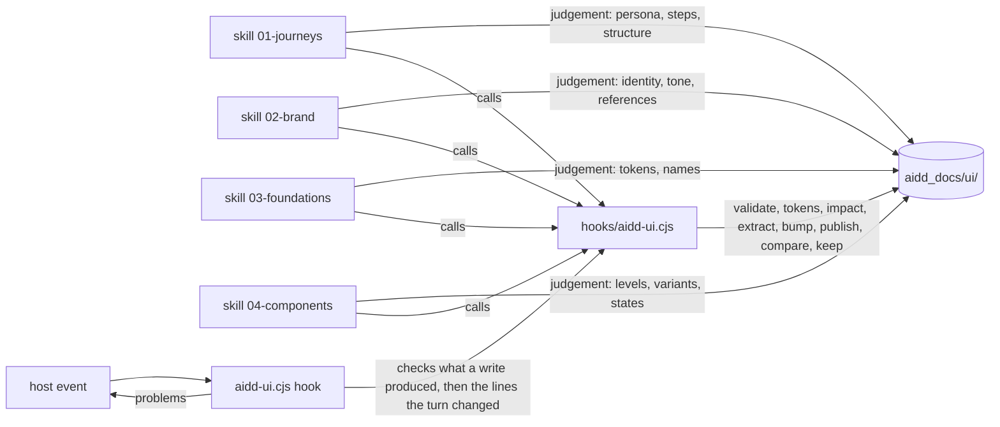

← [aidd-framework](../../README.md)

# aidd-ui

UI and UX design.

| | |
| --- | --- |
| Status | alpha |
| Install | `/plugin install aidd-ui@aidd-framework` |
| Start with | `/aidd-ui:01-journeys` |
| Skills, agents, hooks | [Catalog](../../docs/CATALOG.md#-aidd-ui) |

> [!WARNING]
> Not ready for use.
> Skills and names may change or disappear without notice.

## How it works

## Start

1. Install the plugin; its hook needs `node` on `PATH`.
2. Run `/aidd-ui:01-journeys` in your project to map a persona's journeys and the wireframe of each screen they cross.
3. Run `/aidd-ui:02-brand`, then `/aidd-ui:03-foundations`, then `/aidd-ui:04-components`: the brand proposes directions and compares them, and each skill writes its records under `aidd_docs/ui/`; foundations stops without a brand, components without a system.

## Limits

- The frames of a comparison page are not sandboxed: a variant's render runs as written.
- A comparison page is a file to open, with no server. Its feedback is copied and pasted in the chat, in any browser.
- The hook command names `${CLAUDE_PLUGIN_ROOT}` unquoted, and the OpenCode and Kilo bridges replay only that form: a plugin path with spaces breaks it.
- Cursor: the stop is proven on a payload, not in `-p`.
- A journey step may name an existing screen without a wireframe: a screen cites its wireframe only once screens are dressed. A wireframe stays `proposed`, `publish` taking elements alone, until screens come with their review.
- The hook never holds the turn on an error the turn did not produce. After a write it reports the lines the write added or changed, then the errors new in other files, once per turn, to inform. Stop asks once for the errors on the lines the turn changed, never one with no line (a missing section, a token): `validate` holds those.
- New means absent from the errors the project held at the session's start or the last turn's end. An error made by hand between two turns counts as new for the next one, to inform only. A code file joins the baseline at the end of the first turn that writes it: until then the hook never reads its text, so an error made by hand in it is not reported, and a whole-file write to it that does not say what it replaced holds nothing. Without that baseline (a session started before the plugin), nothing of another file is reported, and a write proves its lines only when the host says what it replaced: Claude Code's whole-file write does, and a patch or an edit on Codex, Copilot, OpenCode and Kilo does, even one that removes nothing. A Cursor write, and a whole-file write on OpenCode or Kilo, never does.
- Every problem prints as `<file>[:<line>] <rule> ["<excerpt>"] => <fix>` under a line counting errors and warnings; the hook never cuts the errors, and caps the warnings at ten.
- In a git repository the code is the files git does not ignore under a code root, untracked ones included; outside one, every file under it is read, its dependencies and builds too. A dot file or folder under a code root (`.env.example`, `.storybook/`) is never read. The hook lists the code but reads the text only of the code files the session wrote, so its cost follows what the session wrote, not the size of the code; `validate` reads all of it. A shell write names no file, so the code files it changed are read only once another write names them.
- A shell write the hook does not know is not seen; it knows redirections, `tee`, `sed -i`, `mv`, `cp`, `rm`, `touch`, `mkdir`, `patch`, `git apply`, `checkout`, `restore` and the engine.
- A key several exports of a script share takes its export's name, so adding such an export renames tokens.
- Overlapping breakpoint queries cascade in the stylesheet: at a width two match, the later keeps a token the earlier alone redefines.
- A palette constant in code (`Colors.blue`, `UIColor.systemBlue`) is a name, as a token is: no colour check finds it. A storyboard's `<color red=…>` is not read either.
- A render shows a variant or state when its text holds the attribute; native behaviour (focus, validity) no render shows.
- The colour debt only grows: the engine never lowers a count, so a literal fixed leaves room for a new one until the file is edited by hand. A moved or renamed code file loses its debt, a code root added later has none, and a deleted `code-debt.json` is never written again.
- A validated element's fingerprint covers its record, render, asset file and the resolved value of each token it uses: adding or removing a theme, platform or breakpoint changes it for every element using a token, and so does a checkout that changes an asset's line ends.
- A token change stops at `aidd_docs/ui/`: the skill never writes the code. C10 names each value of the code's token files (`code-tokens`) that is no longer the design system's, until the code follows. A token or context the code's files do not hold, and an `@media` block matching no breakpoint, are not compared.
