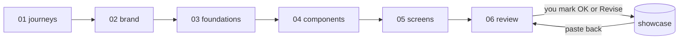

← [aidd-framework](../../README.md)

# aidd-ui

Design the screens of your app, review them in a showcase, publish what you approve.

| | |
| --- | --- |
| Status | beta, off the recommended path |
| Install | [Add the Claude Code marketplace](../../docs/INSTALL.md#marketplace), then run `/plugin install aidd-ui@aidd-marketplace` |
| Start with | `/aidd-ui:01-journeys` |
| Skills, agents, hooks | [Catalog](../../docs/CATALOG.md#-aidd-ui) |
| Limits | [UI limits](../../aidd_docs/product/ui-limits.md) |

## How it works

Each skill writes under `aidd_docs/ui/`. The showcase is `aidd_docs/ui/showcase/index.html`, a file to open in any browser.

## Start

1. Install; its hook needs `node` on `PATH`.
2. Run the six skills in order. Each stops if the one before is missing.
3. Open the showcase, mark each record OK or Revise, paste the copy back into `/aidd-ui:06-review`.

## Scope

- Designs and validates screens. It never writes your app's code.
- Proven with Claude Code.
