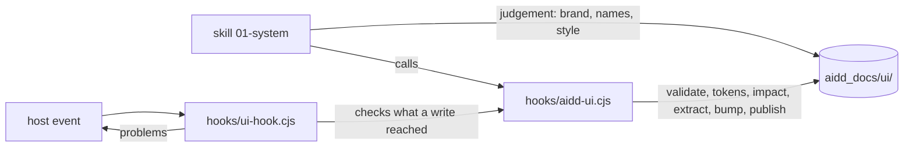

← [aidd-framework](../../README.md)

# aidd-ui

UI and UX design.

| | |
| --- | --- |
| Status | alpha |
| Install | `/plugin install aidd-ui@aidd-framework` |
| Start with | `/aidd-ui:01-system` |
| Skills, agents, hooks | [Catalog](../../docs/CATALOG.md#-aidd-ui) |

> [!WARNING]
> Not ready for use.
> Skills and names may change or disappear without notice.

## How it works

## Start

1. Install the plugin; its hook needs `node` on `PATH`.
2. Run `/aidd-ui:01-system` in your project.
3. Follow the skill: it writes the design system under `aidd_docs/ui/`.

## Limits

- The hook command names `${CLAUDE_PLUGIN_ROOT}` unquoted, and the OpenCode and Kilo bridges replay only that form: a plugin path with spaces breaks it.
- Cursor: the stop is proven on a payload, not in `-p`.
- Stop checks what the turn's writes reached, as after a write; once a shell command marked the turn, it checks every file, since the hook cannot tell which ones the command wrote.
- A shell write the hook does not know is not seen; it knows redirections, `tee`, `sed -i`, `mv`, `cp`, `rm`, `touch`, `mkdir`, `patch`, `git apply`, `checkout`, `restore` and the engine.
- Overlapping breakpoint queries cascade in the stylesheet: at a width two match, the later keeps a token the earlier alone redefines.
- A palette constant in code (`Colors.blue`, `UIColor.systemBlue`) is a name, as a token is: no colour check finds it. A storyboard's `<color red=…>` is not read either.
- A render shows a variant or state when its text holds the attribute; native behaviour (focus, validity) no render shows.
