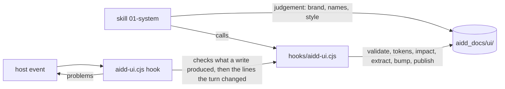

← [aidd-framework](../../README.md)

# aidd-ui

UI and UX design.

| | |
| --- | --- |
| Status | alpha |
| Install | `/plugin install aidd-ui@aidd-framework` |
| Start with | `/aidd-ui:01-system` |
| Skills, agents, hooks | [Catalog](../../docs/CATALOG.md#-aidd-ui) |

> [!WARNING]
> Not ready for use.
> Skills and names may change or disappear without notice.

## How it works

## Start

1. Install the plugin; its hook needs `node` on `PATH`.
2. Run `/aidd-ui:01-system` in your project.
3. Follow the skill: it writes the design system under `aidd_docs/ui/`.

## Limits

- The hook command names `${CLAUDE_PLUGIN_ROOT}` unquoted, and the OpenCode and Kilo bridges replay only that form: a plugin path with spaces breaks it.
- Cursor: the stop is proven on a payload, not in `-p`.
- The hook never holds the turn on an error the turn did not produce. After a write it reports the lines the write added or changed, then the errors new in other files, once per turn, to inform. Stop asks once for the errors on the lines the turn changed, never one with no line (a missing section, a token): `validate` holds those.
- New means absent from the errors the project held at the session's start or the last turn's end. An error made by hand between two turns counts as new for the next one, to inform only. Without that baseline (a session started before the plugin), nothing of another file is reported, and a whole-file write proves its lines only when the host says what it replaced, as Claude Code does.
- Every problem prints as `<file>[:<line>] <rule> ["<excerpt>"] => <fix>` under a line counting errors and warnings; the hook never cuts the errors, and caps the warnings at ten.
- In a git repository the code is the files git does not ignore under a code root, untracked ones included; outside one, every file under it is read, its dependencies and builds too. A dot file or folder under a code root (`.env.example`, `.storybook/`) is never read. A write reads the text of the code files it wrote and no other's; the session's start, a write to `system.md` or `code-debt.json`, and a turn without a baseline read all of it, so their cost grows with the code. A shell write's files are unknown: its turn's end keeps the other files' errors from the last baseline.
- A shell write the hook does not know is not seen; it knows redirections, `tee`, `sed -i`, `mv`, `cp`, `rm`, `touch`, `mkdir`, `patch`, `git apply`, `checkout`, `restore` and the engine.
- Overlapping breakpoint queries cascade in the stylesheet: at a width two match, the later keeps a token the earlier alone redefines.
- A palette constant in code (`Colors.blue`, `UIColor.systemBlue`) is a name, as a token is: no colour check finds it. A storyboard's `<color red=…>` is not read either.
- A render shows a variant or state when its text holds the attribute; native behaviour (focus, validity) no render shows.
- The colour debt only grows: the engine never lowers a count, so a literal fixed leaves room for a new one until the file is edited by hand. A moved or renamed code file loses its debt, a code root added later has none, and a deleted `code-debt.json` is never written again.
- A validated element's fingerprint covers its record, render, asset file and the resolved value of each token it uses: adding or removing a theme, platform or breakpoint changes it for every element using a token, and so does a checkout that changes an asset's line ends.
- A token change stops at `aidd_docs/ui/`: the skill never writes the code. C10 names each value of the code's token files (`code-tokens`) that is no longer the design system's, until the code follows. A token or context the code's files do not hold, and an `@media` block matching no breakpoint, are not compared.
