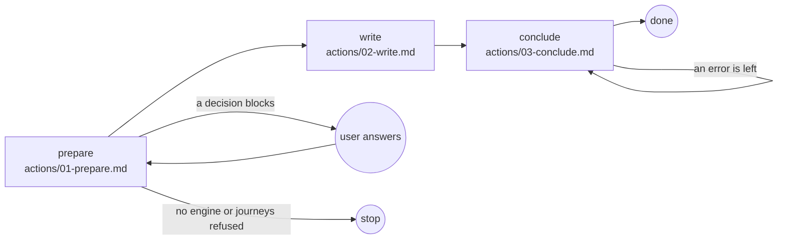

# Journeys

## Actions

Each box is a file: read it, then do what it says.

## Transversal rules

- Speak only to ask or to give the final reply.
- Otherwise call tools.
- Run every command from the project root, the working directory.
- Write only under `aidd_docs/ui/journeys/` and `aidd_docs/ui/wireframes/`.
- After each write, fix what the hook or the validation reports.
- Never bypass a hook.
- Commit and push only when asked.
