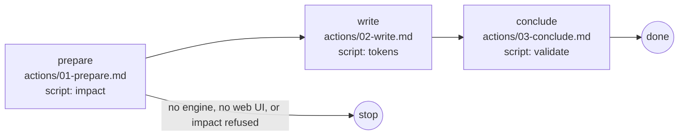

# System

## Actions

Each box is a file: read it, then do what it says.

## Transversal rules

- Speak only to ask or to give the final reply; otherwise call tools.
- Write only under `aidd_docs/ui/`: never the code, never `tokens.css` by hand.
- A record written or changed is `proposed`; only a person validates it.
- Commit and push only when asked; `tokens.css` stays tracked.
