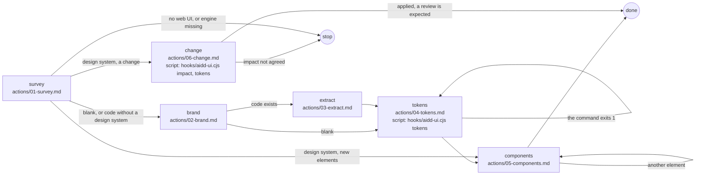

# System

## Actions

Each box is a file: read it, then do what it says.

## Transversal rules

- Speak only to ask, to give the confirmation survey asks for, or to give the final reply; otherwise call tools.
- The engine is the plugin's `hooks/aidd-ui.cjs`, or `<tool folder>/hooks/aidd-ui/aidd-ui.cjs` in a flat install (`.codex`, `.cursor`, `.opencode`), run with node from the project root as `validate`, `tokens` or `impact`; when neither exists, the skill shipped alone, so stop and say the engine is missing.
- Write only under `aidd_docs/ui/`, or the impact report in the task folder, never in the code, and never `tokens.css` by hand: the `tokens` command writes it.
- Every write under `aidd_docs/ui/` is followed by the hook's feedback: fix its problems before going on, colour literals in the code aside, which this skill never edits. Without the hook, run `validate` after each write.
- During setup, the errors of a step not yet done are expected: no tokens yet (T1), no resolver yet (T6), no stylesheet (T10), a record without its render (V1). Fix the others. During a change, a stale stylesheet (T10) is expected until the regenerate step.
- Every History row names the task folder of the work being done, `aidd_docs/tasks/...`; ask for it when it is not known.
- A new or changed record is `proposed`, and only a person validates it: through a review for a screen and, until the review page exists, by hand for a component.
- Commit and push only when asked. `tokens.css` stays tracked, never gitignored: the version guard reads the committed one.
