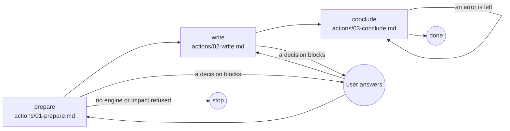

# System

## Actions

Each box is a file: read it, then do what it says.

## Transversal rules

- Speak only to ask or to give the final reply; otherwise call tools.
- Run every command from the project root, the working directory; every path written in a record starts there.
- Write only under `aidd_docs/ui/`, never in the code.
- After each write, fix what the hook or `node <engine> validate` reports, except what [engine](references/engine.md) says a later step owes; never bypass a hook.
- Commit and push only when asked.
