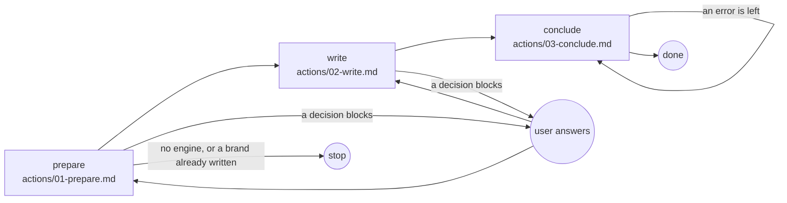

# Brand

## Actions

Each box is a file: read it, then do what it says.

## Transversal rules

- Speak only to ask or to give the final reply.
- Otherwise call tools.
- Run every command from the project root, the working directory.
- Write only `aidd_docs/ui/brand.md`, never in the code.
- After each write, fix what the hook or `node <engine> validate` reports.
- Leave what [engine](references/engine.md) says a later step owes.
- Never bypass a hook.
- Commit and push only when asked.
