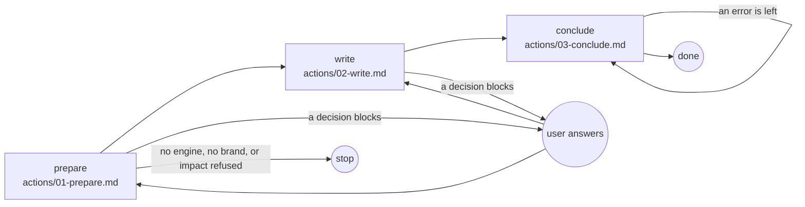

# Foundations

## Actions

Each box is a file: read it, then do what it says.

## Transversal rules

- Speak only to ask or to give the final reply.
- Otherwise call tools.
- Run every command from the project root, the working directory.
- Every path written in a record starts there.
- Write only `system.md`, `tokens.json` and its context files under `aidd_docs/ui/`.
- Never write in the code, nor by hand what the engine writes.
- The engine writes `history.md`, `code-debt.json`, `tokens.css` and `tokens.resolver.json`.
- After each write, fix what the hook or `node <engine> validate` reports.
- Leave what [engine](references/engine.md) says a later step owes.
- Never bypass a hook.
- Commit and push only when asked.
