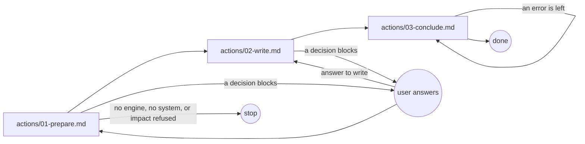

# Components

## Transversal rules

- Read each box's file, then do what it says.
- Call tools, speaking only to ask or to give the final reply.
- After asking, wait for the answer.
- Write each question, option and label in the person's language.
- Say what the person will see, by record title and state label.
- Never show a path, file name, id, rule code, size, version or unit.
- Never show a skill name, history, changelog or warning count.
- Never use jargon like wireframe, design system, token or hex code.
- Say « maquette » for a wireframe, never « plan ».
- Call the showcase « la vitrine » in French, and show a page by pointing to it.
- Say once per conversation: double-click `index.html` in `aidd_docs/ui/showcase/`.
- On a web project, show a width by pointing to the Ordinateur or Téléphone switch.
- Never hand over a capture or a temp file.
- End with one next step or question, never on an offer or a yes/no.
- Save by writing the design files, and never use git unless asked.
- Write only `components/`, `assets/` and `drafts/` under `aidd_docs/ui/`.
- Never write in the code, nor by hand what the engine writes.
- Start every path written in a record at the project root.
