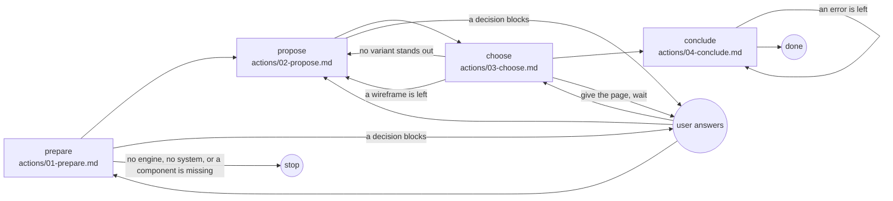

# Screens

## Actions

Each box is a file: read it, then do what it says.

## Transversal rules

- Speak only to ask or to give the final reply.
- After asking, wait for the answer.
- Otherwise call tools.
- Run the engine from the project root; never read its source.
- Every path written in a record starts there.
- Write only `screens/` and `drafts/` under `aidd_docs/ui/`.
- Never write in the code, nor by hand what the engine writes.
- Never create a component: name the missing one and stop.
- After each write, fix what the hook or the validation reports.
- Never bypass a hook.
- Commit and push only when asked.
