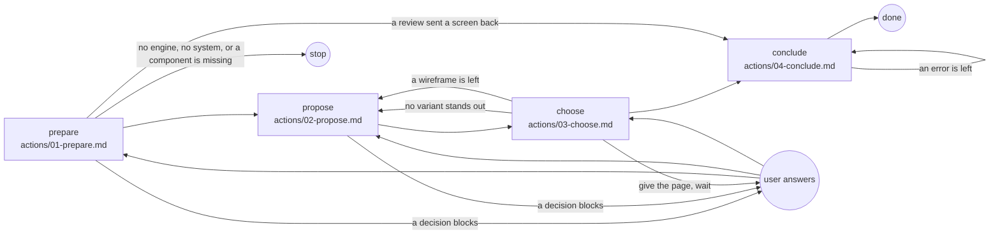

# Screens

## Actions

Each box is a file: read it, then do what it says.

## Transversal rules

- Speak only to ask or to give the final reply.
- Word each question, its options and its labels in the person's language.
- Name a record by its title and a state by its label.
- Say what the person will see, in their words.
- Never show a path, file name, id, rule code or size.
- Never show a version number, skill name, history or changelog.
- Never give a unit, or a count of warnings.
- Never use jargon: no wireframe, design system, token or hex code. Say what it is.
- Say « maquette » for a wireframe, never « plan ».
- Name a step by what it does, never by its skill name.
- Name the showcase plainly, « la vitrine » in French.
- Say once per conversation how to open it: double-click `index.html` in `aidd_docs/ui/showcase/`. Give no other path.
- To show a page, point to it in the showcase.
- Never hand over a capture or a temp file.
- End a reply with one next step or one needed question. Hold the others.
- Never end on an offer or a yes/no about more work.
- A web screen's page has a width switch, Ordinateur or Téléphone. Point to it to show a width.
- After asking, wait for the answer.
- Otherwise call tools.
- Run the engine from the project root; never read its source.
- Every path written in a record starts there.
- Write only `screens/` and `drafts/` under `aidd_docs/ui/`.
- Never write in the code, nor by hand what the engine writes.
- Never create a component: name the missing one and stop.
- After each write, fix what the hook or the validation reports.
- Never bypass a hook.
- Record the history without asking. Change only what was named.
- Saving means writing the design files. Never branch, commit or push unless the person asks for git.
