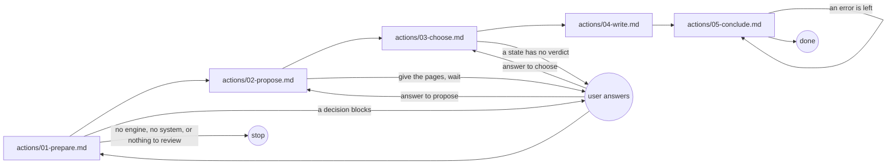

# Review

## Transversal rules

- Read each box's file, then do what it says.
- The project is the working directory the session started in, never this skill's folder: look for its files and write them there.
- Call tools, speaking only to ask or to give the final reply.
- After asking, wait for the answer.
- Write every reply, question, option and label in the language the person writes in, even when the project's own files use another.
- Say what the person will see, by record title and state label.
- Never show a path, file name, id, rule code, size, version or unit.
- Never show a skill name, history, changelog or warning count.
- Never use jargon like wireframe, design system, token or hex code.
- Say « maquette » for a wireframe, never « plan ».
- Call the showcase « la vitrine » in French, and show a page by pointing to it.
- Say once per conversation: double-click `index.html` in `aidd_docs/ui/showcase/`.
- On a web project, show a width by pointing to the Ordinateur or Téléphone switch.
- Never hand over a capture or a temp file.
- End with one next step or question, never on an offer or a yes/no.
- Save by writing the design files, and never use git unless asked.
- Under `aidd_docs/ui/`, write only `reviews/` and the records sent back for rework.
- Never write in the code, nor by hand what the engine writes.
- Never write a capture: the user saves it.
