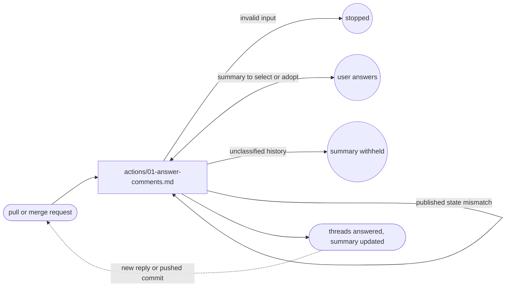

# Answer Comments

## Transversal rules

- Reach the pull or merge request through the VCS tool `aidd_docs/memory/vcs.md` names, else the one the remote points to.
- Read code and history as evidence.
- Never modify source, write a rule, memory or skill, commit, push, or merge the request.
