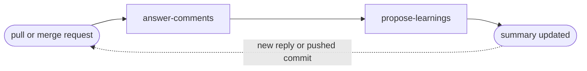

# Answer Comments

## Actions

Run the flow above. Read only the next action file.

| Action | Does |
| --- | --- |
| answer-comments | answer open review threads and resolve the settled ones |
| propose-learnings | propose lasting feedback and update the summary |

## Transversal rules

- Use the VCS tool named in the loaded project context; if absent, consult `aidd_docs/memory/vcs.md`, else infer it from the remote.
- Read code and history as evidence; never modify source, commit, push, or merge the request.
