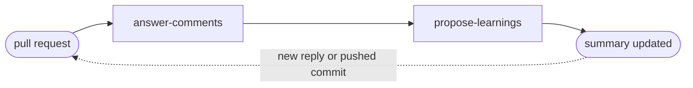

# Answer Comments

## Actions

Run the flow above. Read only the next action file.

| Action | Does |
| --- | --- |
| answer-comments | answer open review threads and resolve the settled ones |
| propose-learnings | propose lasting feedback and update the summary |

## Transversal rules

- Reach the pull or merge request through the VCS tool `aidd_docs/memory/vcs.md` names, else the one the remote points to.
- Read code and history as evidence; never modify source, commit, push, or merge the request.
